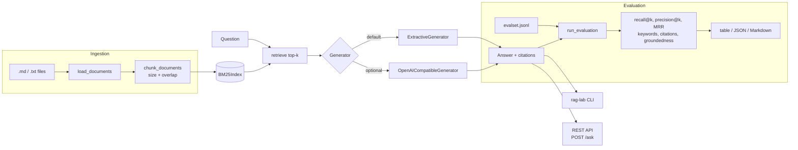

# rag-eval-lab

[](https://github.com/s78519300-creator/rag-eval-lab/actions/workflows/ci.yml)
[](https://www.python.org/)
[](LICENSE)

**Document Q&A with cited answers, plus an evaluation harness that tells you whether those answers are any good.**

rag-eval-lab is a small, readable Retrieval-Augmented Generation (RAG) system:
it loads your documents, retrieves the relevant passages with BM25, and answers
questions with inline citations such as `[refund-policy.md#chunk0]`. Alongside
it ships an evaluation harness that scores retrieval and answer quality over a
labelled question set, so changes to chunking, retrieval or prompts can be
measured instead of eyeballed.

It runs **fully offline with zero dependencies** by default. When you want a
real LLM, point it at any OpenAI-compatible endpoint with three environment
variables.

---

## Why evaluation matters for RAG

A RAG system can fail in several independent places, and a fluent answer hides
all of them:

- **Retrieval misses** - the right passage never reaches the generator, so the
  model answers from nothing (or from its training data).
- **Ranking problems** - the right passage is retrieved, but buried under
  noise that dilutes the context.
- **Unsupported answers** - the generator adds claims that are not in the
  retrieved text.
- **Wrong citations** - the answer points at sources that do not back it up,
  which is arguably worse than no citation at all.

Each of these needs its own metric. "The demo looked fine" does not survive a
new embedding model, a chunk-size tweak or a prompt rewrite. A fixed eval set
with per-question scores does, and it can run in CI on every pull request.

## Features

- **Ingestion** - `.md` / `.txt` loading, word-window chunking with
  configurable size and overlap, stable `doc#chunkN` ids for citations.
- **Retrieval** - pure-Python Okapi BM25 with deterministic top-k ranking.
- **Generation**
  - `ExtractiveGenerator` (default): picks the retrieved sentences that best
    match the question and cites each one. Offline and deterministic, which
    makes it a good baseline and a stable test fixture.
  - `OpenAICompatibleGenerator`: calls any `/chat/completions` endpoint
    (OpenAI, vLLM, Ollama, LM Studio, gateways) using only `urllib`.
- **Evaluation** - recall@k, precision@k, MRR, keyword coverage, citation
  correctness and groundedness; terminal table, JSON and Markdown reports;
  `--fail-under` quality gates for CI.
- **REST API** - `POST /ask` and `GET /health` on the standard library's
  `http.server`.
- **CLI** - `rag-lab ingest | ask | eval | serve`, also available as
  `python -m rag_eval_lab`.

## Architecture



## Quickstart

```bash
git clone https://github.com/s78519300-creator/rag-eval-lab.git
cd rag-eval-lab
pip install -e .            # no runtime dependencies
```

The repository includes a small corpus for a fictional company, Northwind
Cloud (refund policy, SLA, security, onboarding, support), and an 8-question
eval set.

### Index the documents

```console
$ rag-lab ingest --docs examples/docs
Indexed 5 documents into 12 chunks (avg 101.5 words/chunk)
  onboarding.md                2 chunks
  refund-policy.md             2 chunks
  security.md                  3 chunks
  sla.md                       3 chunks
  support.md                   2 chunks
```

### Ask a question

```console
$ rag-lab ask "How long do I have to request a refund on a monthly plan?" --docs examples/docs
Q: How long do I have to request a refund on a monthly plan?

A: Customers on monthly plans can request a full refund within 14 days of their first
   payment. [refund-policy.md#chunk0] After the first 14 days, monthly plans are not
   refundable, but you can cancel at any time and keep access until the end of the
   current billing period. [refund-policy.md#chunk0]

Sources:
 * 1. refund-policy.md#chunk0      score=6.555
   2. refund-policy.md#chunk1      score=4.659
   3. sla.md#chunk0                score=4.154
```

`*` marks the retrieved chunks the answer actually cites. Add `--json` for
machine-readable output or `--show-context` to print the retrieved text.

Questions the corpus cannot answer get an honest refusal rather than a guess:

```console
$ rag-lab ask "What is the capital of France?" --docs examples/docs
Q: What is the capital of France?

A: I could not find an answer to that in the provided documents.

Sources:
```

### Run the evaluation

```console
$ rag-lab eval --docs examples/docs --evalset examples/evalset.jsonl --md-out reports/eval.md
Evaluated 8 questions (k=3, generator=extractive)

id              R@3   P@3   MRR  Keywords  Citations  Grounded
--------------------------------------------------------------
refund-window  1.00  0.67  1.00      1.00       1.00      1.00
refund-usage   1.00  0.33  1.00      1.00       1.00      1.00
sla-uptime     1.00  0.67  1.00      1.00       1.00      1.00
sla-credits    1.00  0.67  1.00      0.50       1.00      1.00
encryption     1.00  1.00  1.00      1.00       1.00      1.00
api-tokens     1.00  0.33  1.00      1.00       1.00      1.00
free-trial     1.00  0.33  1.00      1.00       1.00      1.00
sev1-response  1.00  0.67  1.00      1.00       1.00      1.00
--------------------------------------------------------------
mean           1.00  0.58  1.00      0.94       1.00      1.00

Wrote reports/eval.md
```

Reading this output:

- **Retrieval is solid**: every relevant document is found, always at rank 1
  (recall@3 = MRR = 1.0).
- **Precision@3 is 0.58** because most questions have a single relevant
  document, so the remaining top-3 slots are filled with other documents. On a
  corpus this small that is expected; on a real corpus it is the number to
  watch when tuning `--top-k`.
- **`sla-credits` only scores 0.50 on keywords.** The question asks for the
  credit when uptime drops *below 99.0%* (25%), and the extractive generator
  picks the neighbouring sentence about the 99.0-99.95% band (10%) instead.
  The answer is grounded and correctly cited, yet still wrong. This is exactly
  the kind of failure that only a labelled eval set catches, and it is listed
  under "Questions to review" in the Markdown report.

Use `--json-out` for the full per-question report (answers, citations,
retrieved chunks), and `--fail-under METRIC=VALUE` to make the command exit
non-zero when quality regresses:

```bash
rag-lab eval --docs examples/docs --evalset examples/evalset.jsonl \
  --fail-under recall_at_k=0.9 --fail-under groundedness=0.9
```

## Metrics explained

All metrics are in `[0, 1]`, higher is better, and are averaged across questions.

| Metric | Question it answers | How it is computed |
| --- | --- | --- |
| `recall_at_k` | Did we retrieve what we needed? | Share of the relevant documents that appear among the top-k chunks. |
| `precision_at_k` | How much of the context is noise? | Share of the k retrieval slots filled by chunks from relevant documents. |
| `mrr` | How high is the first good hit? | `1 / rank` of the first chunk from a relevant document (0 if none). |
| `keyword_coverage` | Does the answer contain the key facts? | Share of the expected keywords present in the answer (case-insensitive). |
| `citation_correctness` | Do the citations point at the right sources? | Share of cited chunks that belong to a relevant document; no citations scores 0. |
| `groundedness` | Is the answer supported by the retrieved text? | Share of answer sentences where at least 70% of the content words appear in a single retrieved chunk. |

Retrieval relevance is labelled at the document level. Chunk-level labels go
stale every time the chunking changes; document labels do not, which keeps the
eval set cheap to maintain.

Keyword coverage and groundedness are lexical proxies. They are fast,
deterministic and free, which makes them a good CI gate, but they are not a
substitute for human review or an LLM-as-judge pass on a sample of answers.

### Eval set format

One JSON object per line:

```json
{"id": "api-tokens", "question": "When do API tokens expire?", "expected_keywords": ["90 days"], "relevant_docs": ["security.md"]}
```

`id` and `expected_keywords` are optional. `relevant_docs` uses the document
path relative to `--docs`.

## Plugging in a real LLM

Any OpenAI-compatible chat completions API works. Configuration is read from
the environment so keys never land in code or shell history files:

| Variable | Default | Purpose |
| --- | --- | --- |
| `RAG_LAB_BASE_URL` | `https://api.openai.com/v1` | API base URL |
| `RAG_LAB_MODEL` | `gpt-4o-mini` | Model name |
| `RAG_LAB_API_KEY` | falls back to `OPENAI_API_KEY` | Bearer token (optional for local servers) |

```bash
# Hosted API
export RAG_LAB_API_KEY=...
rag-lab ask "What uptime is guaranteed for managed databases?" \
  --docs examples/docs --generator openai

# Local model through Ollama
export RAG_LAB_BASE_URL=http://localhost:11434/v1
export RAG_LAB_MODEL=llama3.1
rag-lab eval --docs examples/docs --evalset examples/evalset.jsonl --generator openai
```

The model is instructed to cite context blocks by id. Every citation it
produces is kept, including ones that point at chunks it was never shown, so
hallucinated sources show up as a lower `citation_correctness` score instead of
being silently dropped. Running the same eval set with both generators gives
you a direct, like-for-like comparison.

From Python:

```python
from rag_eval_lab import RAGPipeline, OpenAICompatibleGenerator, load_evalset, run_evaluation

pipeline = RAGPipeline.from_path("examples/docs", chunk_size=120, overlap=20, top_k=3)
print(pipeline.ask("When do API tokens expire?").text)

report = run_evaluation(pipeline, load_evalset("examples/evalset.jsonl"))
print(report.format_table())
```

## REST API

```bash
rag-lab serve --docs examples/docs --port 8000
```

```console
$ curl -s -X POST http://127.0.0.1:8000/ask \
    -H "Content-Type: application/json" \
    -d '{"question": "What is the first response time for severity 1 tickets on Premium support?", "top_k": 2}'
{
  "question": "What is the first response time for severity 1 tickets on Premium support?",
  "answer": "For Premium support, critical (severity 1) tickets receive a first response within 15 minutes, at any time of day. [support.md#chunk0]",
  "citations": ["support.md#chunk0"],
  "retrieved": [
    {"chunk_id": "support.md#chunk0", "doc_id": "support.md", "rank": 1, "score": 16.9727},
    {"chunk_id": "support.md#chunk1", "doc_id": "support.md", "rank": 2, "score": 9.4703}
  ]
}

$ curl -s http://127.0.0.1:8000/health
{"status": "ok", "chunks": 12}
```

Invalid input returns `400` with an `{"error": ...}` body; generator failures
(for example an unreachable LLM endpoint) return `502`. The server is built on
`http.server` and intended for demos and local integration, not production
traffic.

## Project structure

```
rag-eval-lab/
├── src/rag_eval_lab/
│   ├── __init__.py       # public API
│   ├── __main__.py       # python -m rag_eval_lab
│   ├── api.py            # stdlib REST API (POST /ask, GET /health)
│   ├── cli.py            # rag-lab command line
│   ├── evaluation.py     # metrics, harness and reports
│   ├── generation.py     # extractive + OpenAI-compatible generators
│   ├── ingest.py         # document loading and chunking
│   ├── pipeline.py       # retrieve-then-generate pipeline
│   ├── retrieval.py      # BM25 index
│   └── text.py           # tokenising and sentence splitting
├── tests/                # pytest suite (unit, CLI and HTTP tests)
├── examples/
│   ├── docs/             # Northwind Cloud sample corpus
│   └── evalset.jsonl     # labelled questions
├── .github/workflows/ci.yml
├── pyproject.toml
├── CHANGELOG.md
├── CONTRIBUTING.md
└── LICENSE
```

## Development

```bash
pip install -e ".[dev]"
pytest
ruff check .
```

CI runs the test suite on Python 3.9 to 3.12, lints with ruff, and runs
`rag-lab eval` against the example set with quality gates. The Markdown report
is published to the workflow summary.

## Roadmap

- [ ] Dense and hybrid retrieval (BM25 + embeddings with reciprocal rank fusion)
- [ ] Optional LLM-as-judge metrics for faithfulness and answer relevance
- [ ] Compare two eval runs and highlight regressions per question
- [ ] Sentence-aware chunking and PDF/HTML loaders
- [ ] Persisted index so large corpora are not re-indexed on every command
- [ ] Unanswerable questions in the eval set, scored on correct refusals

## License

Released under the [MIT License](LICENSE).

---

Built by Shalu Kumari - [LinkedIn](https://www.linkedin.com/in/shalu-kumari-a20616188)
